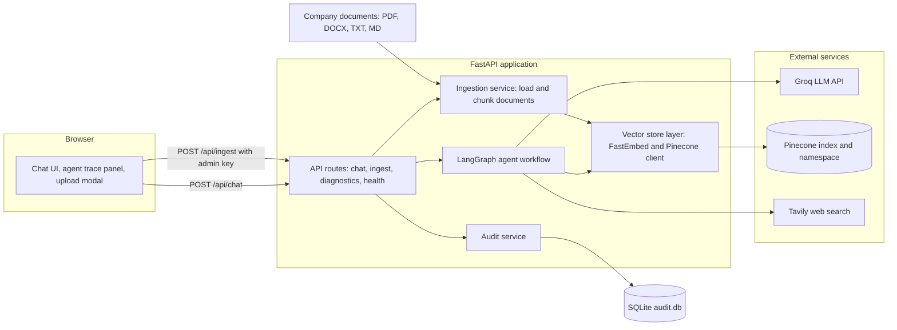
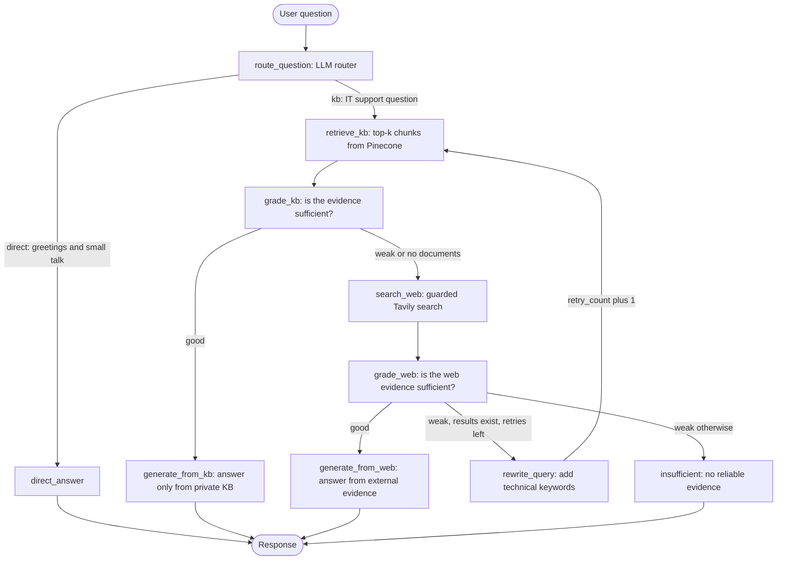
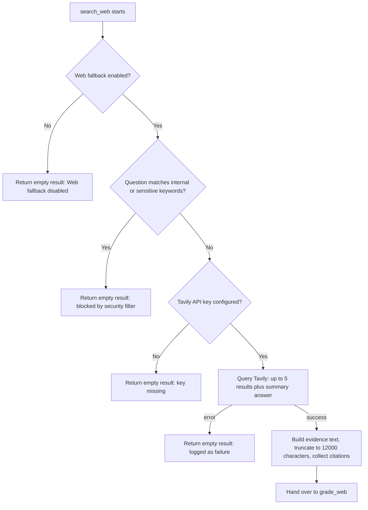
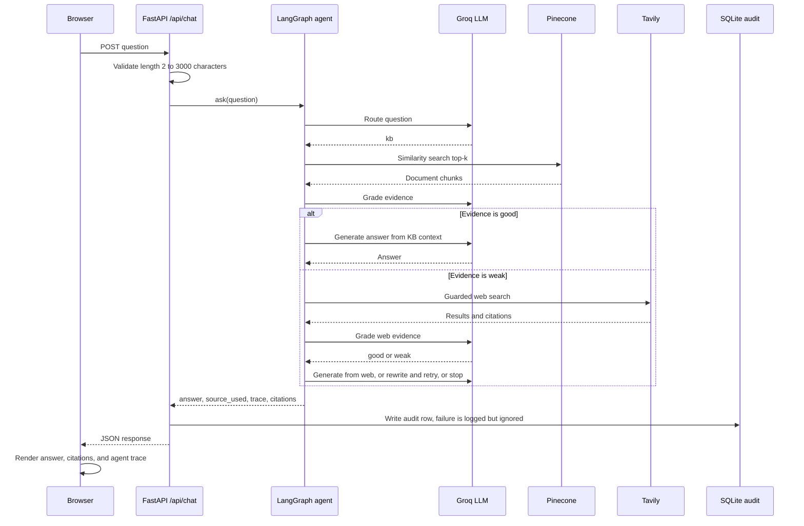
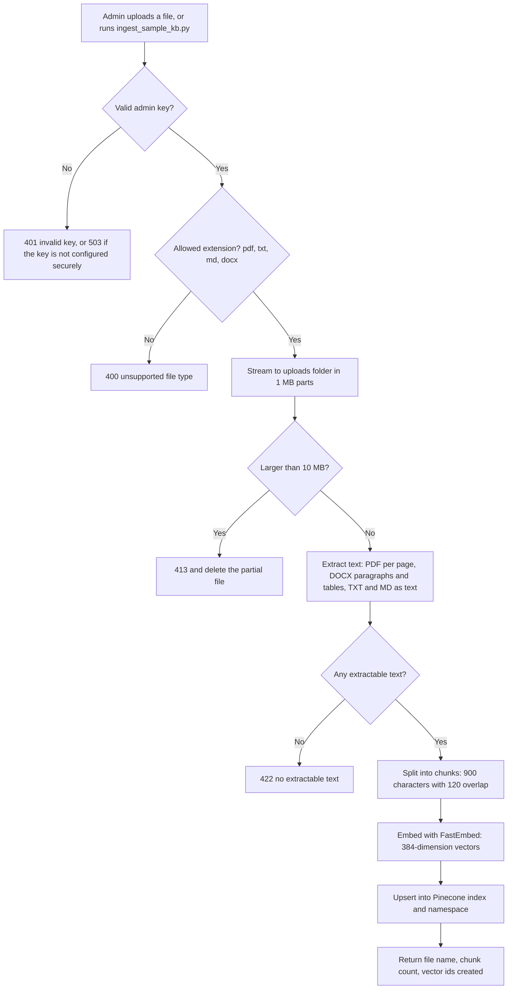

# Enterprise IT Support Agentic RAG Copilot

An agentic Retrieval-Augmented Generation (RAG) assistant for IT support. It answers questions from a **private company knowledge base first**, grades its own evidence, and only falls back to **external web search** when the private knowledge is not good enough, with guardrails that stop sensitive questions from leaving the company.

The decision flow is orchestrated as a **LangGraph state machine**, so every request follows an explicit, inspectable path (route, retrieve, grade, fall back, rewrite, answer) and the full path is returned to the UI as an **agent trace**.

---

## Table of contents

1. [Why this project](#why-this-project)
2. [Key features](#key-features)
3. [Tech stack](#tech-stack)
4. [High-level design (HLD)](#high-level-design-hld)
5. [Agent workflow](#agent-workflow)
6. [Request lifecycle](#request-lifecycle)
7. [Document ingestion pipeline](#document-ingestion-pipeline)
8. [Agent state](#agent-state)
9. [Security and guardrails](#security-and-guardrails)
10. [Project structure](#project-structure)
11. [Getting started](#getting-started)
12. [Configuration](#configuration)
13. [API reference](#api-reference)
14. [Example queries](#example-queries)
15. [Audit logging](#audit-logging)
16. [Design decisions](#design-decisions)
17. [Limitations and roadmap](#limitations-and-roadmap)
18. [License](#license)

---

## Why this project

A plain chatbot invents answers about company policy, and a plain RAG pipeline answers confidently even when retrieval returns irrelevant chunks. IT support needs better: answers grounded in the company's own runbooks, an honest "I don't know" when evidence is weak, and a safe way to look up public vendor information (for example, a current Microsoft Teams outage) without leaking internal questions.

This project solves that with a **self-correcting retrieval loop**: retrieve, grade the evidence, then either answer, fall back to the web, rewrite the query and retry, or stop with an insufficient-evidence response.

---

## Key features

- **Agentic routing:** an LLM router sends IT questions to retrieval and small talk to a direct reply.
- **Private knowledge base first:** semantic search over company documents stored in Pinecone.
- **Evidence grading:** an LLM grader decides whether retrieved context is good enough before any answer is written.
- **Guarded web fallback:** Tavily web search is used only when private evidence is weak, and is blocked for internal or sensitive questions.
- **Query rewriting and retry:** when web evidence is weak, the question is rewritten with better technical keywords and retrieval is retried (bounded by `MAX_RETRIES`).
- **Honest failure mode:** if no reliable evidence exists, the assistant says so and points the user to the IT help desk.
- **Citations:** private KB answers cite source files, web answers cite URLs.
- **Agent trace panel:** the UI shows each decision the graph made.
- **Admin document ingestion:** upload PDF, DOCX, TXT, or Markdown through the UI or API, protected by an admin key.
- **Audit log:** every question, final source, and trace is stored in SQLite.
- **Lightweight embeddings:** FastEmbed (ONNX, no PyTorch) keeps the container small.

---

## Tech stack

| Layer | Technology |
|---|---|
| API and web server | FastAPI, Uvicorn |
| Agent orchestration | LangGraph, LangChain Core |
| LLM | Groq (`llama-3.3-70b-versatile` by default) |
| Vector database | Pinecone serverless (cosine, 384 dimensions) |
| Embeddings | FastEmbed, `sentence-transformers/all-MiniLM-L6-v2` |
| Web search | Tavily |
| Document parsing | pypdf, python-docx, LangChain text splitters |
| Audit storage | SQLite |
| Frontend | Jinja2 template, vanilla JavaScript, CSS |
| Packaging | Docker (Python 3.11 slim) |

---

## High-level design (HLD)



**Reading the diagram**
- The browser talks only to FastAPI. All keys (Groq, Pinecone, Tavily) stay on the server.
- The **agent workflow** is the core. It calls Groq for routing, grading, rewriting, and answer generation, Pinecone for private retrieval, and Tavily for guarded web fallback.
- The **ingestion service** and the agent share the same vector store layer, so uploaded documents are searchable immediately.
- Audit logging is separate from the answer path, so a logging failure never breaks a user response.

---

## Agent workflow

This is the LangGraph graph compiled in `app/rag/workflow.py`.



### Inside the web fallback node

The fallback is deliberately defensive. Internal-looking questions never reach the internet.



### Node reference

| Node | Responsibility | Output written to state |
|---|---|---|
| `route_question` | Classify as `kb` or `direct` with structured JSON output | `source_used`, `trace` |
| `retrieve_kb` | Semantic search in Pinecone using `current_query` | `kb_docs`, `trace` |
| `grade_kb` | Judge whether retrieved chunks answer the question (`good` or `weak`) | `kb_grade`, `trace` |
| `search_web` | Guarded Tavily search with citation extraction | `web_results`, `citations`, `source_used` |
| `grade_web` | Judge whether web evidence answers the question | `web_grade`, `trace` |
| `rewrite_query` | Rewrite the question with technical keywords and increment the retry counter | `current_query`, `retry_count` |
| `generate_from_kb` | Answer only from private KB context, cite source files | `answer`, `citations` |
| `generate_from_web` | Answer only from web evidence, treat it as untrusted | `answer`, `citations` |
| `direct_answer` | Short conversational reply, no retrieval | `answer` |
| `insufficient` | Honest "not enough reliable evidence" response | `answer` |

---

## Request lifecycle



---

## Document ingestion pipeline

Documents enter the knowledge base through the admin upload API or the bulk script `ingest_sample_kb.py`. Both use the same loading, chunking, and indexing code.



Each chunk keeps its metadata (`source` file name, `page` for PDFs, and start index), which is what powers the citations in answers.

---

## Agent state

The graph passes a single typed state object between nodes (`app/rag/state.py`).

| Field | Type | Purpose |
|---|---|---|
| `question` | str | Original user question |
| `current_query` | str | Query used for retrieval and search (may be rewritten) |
| `kb_docs` | list of Document | Chunks retrieved from Pinecone |
| `kb_grade` | str | `good` or `weak` |
| `web_results` | str | Combined Tavily evidence text |
| `web_grade` | str | `good` or `weak` |
| `answer` | str | Final answer |
| `source_used` | str | `private_kb`, `web_search`, `direct`, or `insufficient_evidence` |
| `citations` | list of dict | Source files or URLs with type `private_kb` or `web` |
| `retry_count` | int | Number of query rewrites so far |
| `trace` | list of str | Human-readable log of every decision |

Structured LLM outputs use small Pydantic models: `RouteDecision` (`kb` or `direct`) and `EvidenceGrade` (`good` or `weak`), with safe fallbacks if the model returns anything else.

---

## Security and guardrails

| Concern | Protection |
|---|---|
| Leaking internal questions to the internet | A keyword filter blocks web search for questions mentioning company, internal, confidential, private, employee, tenant, API key, password, MFA, VPN, or secret |
| Prompt injection through documents or web pages | Prompts instruct the model to treat retrieved content and web content as reference material, not instructions |
| Hallucinated policy | KB answers are restricted to retrieved context, and weak evidence leads to an explicit "insufficient evidence" reply |
| Unauthorized uploads and diagnostics | `X-Admin-Key` header, compared with `hmac.compare_digest`, and the service refuses to run admin routes while the key is the default `change-me` |
| Malicious uploads | Extension allow-list, hidden-file rejection, file name sanitized to its base name, 10 MB streaming limit, partial files deleted on failure |
| Secrets exposure | Keys come from environment variables, `.env` is git-ignored and Docker-ignored, error responses never include credentials |
| XSS in the chat UI | All model output and citations are HTML-escaped before rendering |
| Retry loops | Query rewriting is capped by `MAX_RETRIES` |

---

## Project structure

```
agentic_rag_it_support/
├── app/
│   ├── main.py                 # FastAPI app, startup, static files, home page
│   ├── api/
│   │   └── routes.py           # /api/health, /api/diagnostics, /api/chat, /api/ingest
│   ├── core/
│   │   ├── config.py           # Settings loaded from environment and .env
│   │   └── logging.py          # Logging setup
│   ├── rag/
│   │   ├── state.py            # AgentState and structured output schemas
│   │   ├── vectorstore.py      # FastEmbed, Pinecone index and retriever (thread-safe singletons)
│   │   └── workflow.py         # LangGraph nodes, edges, and ask() entry point
│   └── services/
│       ├── ingestion.py        # Load PDF, DOCX, TXT, MD and chunk text
│       └── audit.py            # SQLite audit log
├── data/
│   └── sample_kb/              # Sample IT handbook and service desk runbook
├── static/                     # CSS and JavaScript for the UI
├── templates/index.html        # Chat UI with workflow panel and trace panel
├── ingest_sample_kb.py         # Bulk-index the sample knowledge base
├── create_project.py           # Scaffolding helper used to create the folder layout
├── run.py                      # Local development server
├── Dockerfile
├── requirements.txt
└── LICENSE
```

---

## Getting started

### Prerequisites
- Python 3.11
- A [Groq](https://console.groq.com) API key
- A [Pinecone](https://www.pinecone.io) API key (the index is created automatically if it does not exist)
- Optional: a [Tavily](https://tavily.com) API key for web fallback

### 1. Install

```bash
conda create -n project python=3.11 -y
conda activate project
pip install -r requirements.txt
```

### 2. Configure

Create a `.env` file in the project root:

```env
GROQ_API_KEY=your_groq_key
PINECONE_API_KEY=your_pinecone_key
TAVILY_API_KEY=your_tavily_key        # optional
ADMIN_API_KEY=use-a-long-random-value # must not be "change-me"
```

### 3. Index the sample knowledge base

```bash
python ingest_sample_kb.py
```

This reads every supported file in `data/sample_kb/`, chunks it, embeds it, and uploads the vectors to Pinecone.

### 4. Run

```bash
python run.py
```

Open http://127.0.0.1:8080.

### 5. Verify the deployment

```bash
curl -H "X-Admin-Key: <your admin key>" "http://127.0.0.1:8080/api/diagnostics?deep=true"
```

`ready_for_kb_questions: true` means Groq, Pinecone, and the embedding model are all working.

### Run with Docker

```bash
docker build -t it-support-rag .
docker run -p 8080:8080 --env-file .env it-support-rag
```

The image downloads the embedding model at build time, so the first request is not slowed down by a model download. `.env` is excluded from the image, so pass it with `--env-file`.

---

## Configuration

All settings are read from environment variables or `.env` (names are case-insensitive).

| Variable | Default | Description |
|---|---|---|
| `GROQ_API_KEY` | none | Required for routing, grading, and answering |
| `GROQ_MODEL` | `llama-3.3-70b-versatile` | Groq chat model |
| `PINECONE_API_KEY` | none | Required for retrieval and ingestion |
| `PINECONE_INDEX_NAME` | `fde-it-support-minilm` | Index name (created if missing) |
| `PINECONE_NAMESPACE` | `company-it-kb` | Namespace used for all vectors |
| `PINECONE_CLOUD` / `PINECONE_REGION` | `aws` / `us-east-1` | Serverless index location |
| `EMBEDDING_MODEL` | `sentence-transformers/all-MiniLM-L6-v2` | FastEmbed model (384 dimensions) |
| `EMBEDDING_CACHE_DIR` | `.cache/fastembed` | Local model cache |
| `TAVILY_API_KEY` | none | Optional, enables web fallback |
| `WEB_FALLBACK_ENABLED` | `true` | Master switch for external web search |
| `TOP_K` | `4` | Chunks retrieved per query |
| `MAX_RETRIES` | `1` | Maximum query rewrites |
| `ADMIN_API_KEY` | `change-me` | Protects ingestion and diagnostics. Must be changed |
| `AUDIT_DB_PATH` | `data/audit.db` | SQLite audit database |
| `UPLOAD_DIR` | `uploads` | Where uploaded documents are saved |
| `SAMPLE_KB_DIR` | `data/sample_kb` | Folder used by `ingest_sample_kb.py` |

If you change the embedding model, the vector dimension changes, so use a new Pinecone index name. The app checks the dimension on startup and refuses to run on a mismatch.

---

## API reference

| Method | Endpoint | Auth | Description |
|---|---|---|---|
| GET | `/` | none | Chat UI |
| GET | `/api/health` | none | Liveness check (does not test external services) |
| GET | `/api/diagnostics?deep=true` | `X-Admin-Key` | Configuration, Pinecone stats, optional embedding test |
| POST | `/api/chat` | none | Ask a question, runs the full agent workflow |
| POST | `/api/ingest` | `X-Admin-Key` | Upload and index a document (max 10 MB) |

### Chat

```bash
curl -X POST http://127.0.0.1:8080/api/chat \
  -H "Content-Type: application/json" \
  -d '{"question": "How do I connect to the company VPN?"}'
```

Response:

```json
{
  "answer": "Based on the company's private knowledge base: 1. Install the NovaSecure VPN client ...",
  "source_used": "private_kb",
  "trace": [
    "Router → KB",
    "Private KB retrieval → 4 chunks",
    "KB evidence grade → GOOD",
    "Answer generation → PRIVATE KB"
  ],
  "citations": [
    { "title": "company_it_handbook.md", "url": "", "type": "private_kb" }
  ],
  "rewritten_query": "How do I connect to the company VPN?"
}
```

### Ingest a document

```bash
curl -X POST http://127.0.0.1:8080/api/ingest \
  -H "X-Admin-Key: <your admin key>" \
  -F "file=@runbook.pdf"
```

---

## Example queries

| Question | Expected path |
|---|---|
| "How do I connect to the company VPN?" | Router → KB → grade good → private KB answer with `company_it_handbook.md` citation |
| "What is our password reset policy?" | Private KB answer (internal wording also keeps it off the web) |
| "What are the ticket priority levels?" | Private KB answer from `service_desk_runbook.md` |
| "What is the latest Microsoft Teams outage guidance?" | KB grade weak → Tavily web search → grade → web answer with URL citations |
| "Hello" | Router → direct answer, no retrieval |
| A question with no relevant documents and no web results | Insufficient-evidence reply |

The trace panel in the UI shows exactly which of these paths each question took.

---

## Audit logging

Every chat request is stored in the SQLite table `query_audit`:

| Column | Description |
|---|---|
| `id` | Auto-increment primary key |
| `created_at` | UTC timestamp |
| `question` | The user's question |
| `source_used` | Final answer source |
| `trace_json` | The full agent trace as JSON |

This makes it possible to review which questions the knowledge base could not answer and which documents to add next. Audit failures are logged but never block the user's response.

---

## Design decisions

| Decision | Reason |
|---|---|
| LangGraph instead of a linear chain | Branching, retry loops, and fallbacks are explicit graph edges, which makes behavior testable and the trace natural to produce |
| Grade evidence before answering | Prevents confident answers built on irrelevant chunks, the most common RAG failure |
| Private KB before web | Company policy must come from company documents, and web search is only for public vendor information |
| Keyword guard on web fallback | Cheap, predictable protection against sending internal questions to a third party |
| FastEmbed (ONNX) instead of PyTorch embeddings | Much smaller image and faster cold start, with good quality for short IT documents |
| Pinecone serverless | No infrastructure to manage, index is created automatically |
| Thread-safe lazy singletons | LLM, embedding model, and Pinecone clients are initialized once and shared across requests |
| SQLite audit log | Zero-setup traceability suited to a single-instance deployment |
| Vanilla JS frontend | No build step, easy to deploy and review |

---

## Limitations and roadmap

**Current limitations**
- Single-turn: each question is answered independently, with no conversation memory.
- The keyword guard is intentionally blunt: questions containing words like "VPN", "password", or "MFA" never use the web, even for public vendor topics.
- Re-uploading the same document creates duplicate vectors, because chunk ids are generated per upload.
- Retrieval is dense-only with a fixed `TOP_K`, and the grader sees each chunk truncated to 3000 characters.
- The chat endpoint has no user authentication or rate limiting.
- No automated test suite yet.

**Ideas for next steps**
- Conversation memory and follow-up question handling
- Hybrid search (BM25 plus vectors) and a reranker
- Deduplication and document versioning in ingestion (deterministic chunk ids, delete-by-source)
- Streaming responses and per-node progress in the trace panel
- Evaluation harness: a labelled question set measuring retrieval hit rate and answer faithfulness
- User authentication, rate limiting, and role-based document access
- Ticket creation or escalation tool when evidence is insufficient
- Move the audit log to PostgreSQL and add an analytics view of unanswered questions

---

## License

See the [LICENSE](LICENSE) file.
